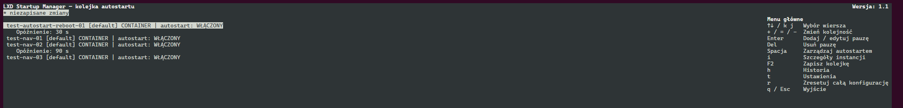

# LXD Startup Manager

-3776AB?logo=python&logoColor=white)

**LXD Startup Manager** to narzędzie dla **Ubuntu Server 26.04 LTS** służące do zarządzania kolejką autostartu lokalnych instancji **Canonical LXD** (kontenerów oraz maszyn wirtualnych we wszystkich projektach LXD).

Aplikacja udostępnia terminalowy interfejs użytkownika (**TUI**) wzorowany na klasycznym menu BIOS-u, w którym administrator definiuje dokładną kolejność uruchamiania instancji oraz opcjonalne przerwy czasowe między nimi.

---

## Wymagania systemowe

| Komponent | Wymaganie |
| :--- | :--- |
| **System operacyjny** | Wyłącznie **Ubuntu Server 26.04 LTS**. |
| **Init / usługi** | Działający `systemd`.|
| **Środowisko Python** | Systemowy `/usr/bin/python3` wraz z modułami standardowymi (`curses`, `sqlite3`, `subprocess`, `urllib`, `ssl`, `fcntl`). |
| **Serwer LXD** | Zainstalowany i skonfigurowany lokalnie **Canonical LXD** jako snap. |

---

## Instalacja 

1. Pobierz najnowszą stabilną wersję.
2. Wypakuj archiwum.
3. W katalogu, gdzie wypakowałeś aplikację wykonaj `chmod +x install.sh`.
4. Uruchom instalację poleceniem `sudo ./install.sh`.
5. Aby uruchomić aplikację wykonaj `sudo lxd-startup-manager`.

## Czy to AI Slop?

Tak, narzędzie zostało napisane z wykorzystaniem LLM. 

## Jaki problem to rozwiązuje?

Oprogramowanie Canonical LXD posiadał własne zarządzanie autostartem instancji, jednak potrzebowałem czegoś pseudograficznego.

## Rozwój

Aplikację rozwijam na własne potrzeby, udostępniam bo może komuś się przyda.